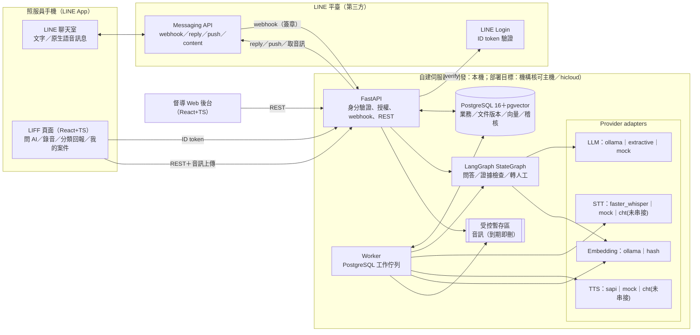
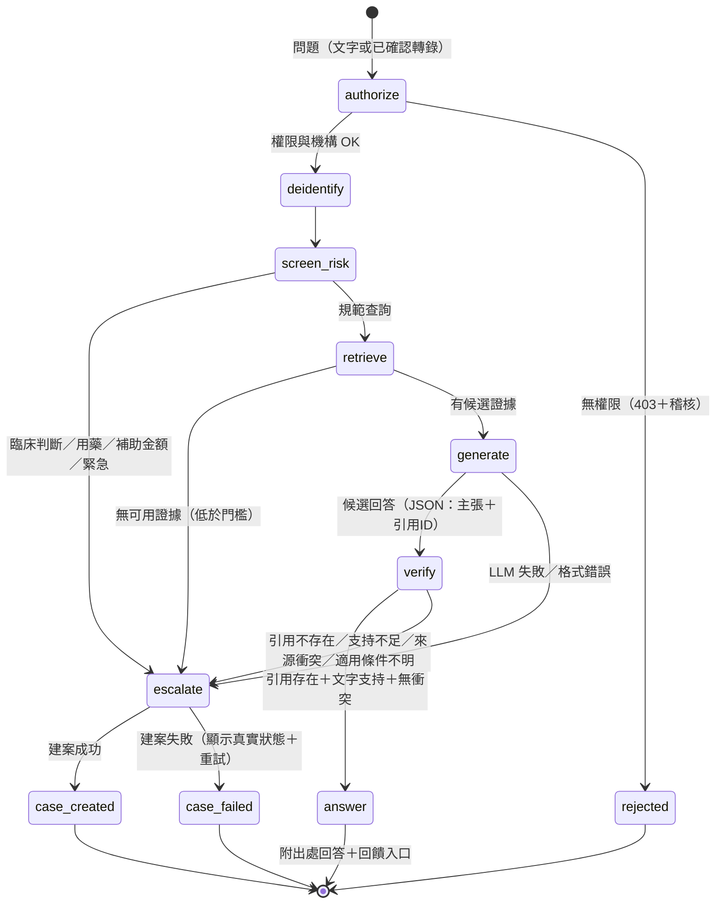
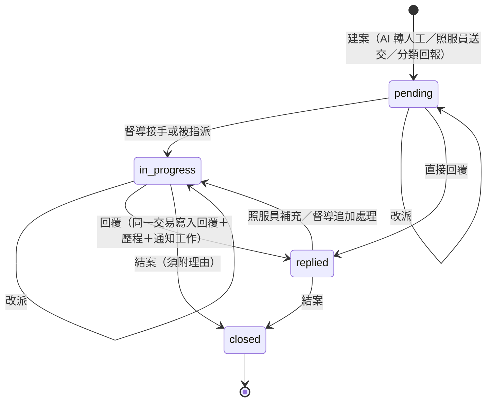
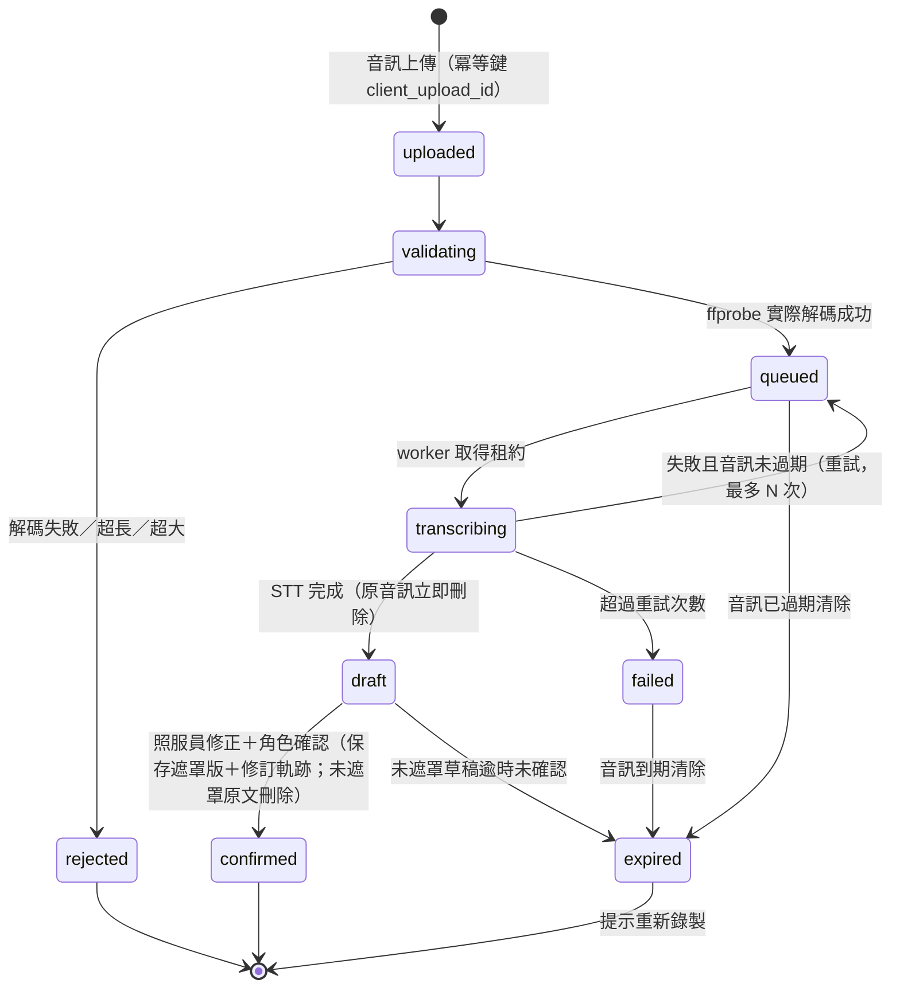
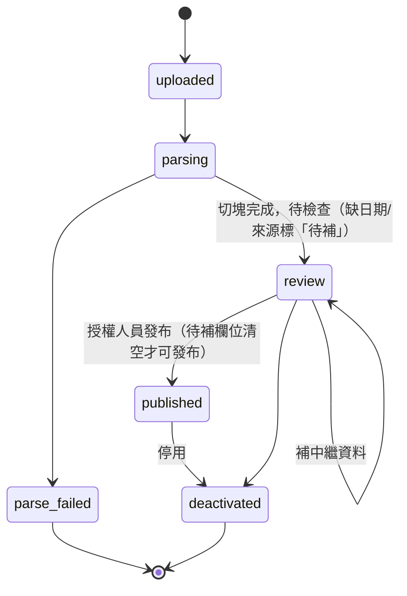

# 系統架構

## 1. 元件總覽

**設計原則**

1. **只有兩個合法出口**：附出處回答，或轉督導（建案）。第三種狀態是「建案失敗」，照實顯示並提供重試，不假裝已轉交。
2. **分解權在圖裡**：問答是需要被審計的流程，走 LangGraph StateGraph，節點與分支寫死、每一步留痕（本專案「可審計 vs 可泛化」判準的可審計側）。
3. **Provider 隔離**：STT、TTS、LLM、embedding 各有 adapter，模式由環境變數決定；**mock／extractive 模式在 API 回應與畫面上標示**，不算真實串接。
4. **單一資料庫**：PostgreSQL 同時放業務資料、文件版本、向量、稽核與工作佇列，交易邊界一致，備份一次。
5. **不信任的資料**：文件、逐字稿、檢索內容、LLM 輸出一律視為資料；LLM 不握有任何工具權限，輸出受 JSON schema 約束，引用 ID 必須屬於本次檢索結果。

## 2. 執行拓樸

| 環境 | db | api／worker | 前端 | 推論 |
|---|---|---|---|---|
| 本機開發（ROG-HOME） | Docker（WSL）`pgvector/pgvector:pg16`，埠 55432 | Windows 主機 Python 3.11 venv（可用 GPU、SAPI、Ollama） | Vite dev server 5173，代理 `/api` | Ollama `gemma4:e4b`、faster-whisper large-v3（CUDA）、SAPI zh-TW |
| Docker Compose 展示 | 同上 | 容器 | nginx 靜態＋反向代理 | 預設 extractive／hash／mock；可指向外部 Ollama |
| 部署目標 | 機構核可主機／hicloud（**未驗證**） | 同 | 同 | 中華電信 STT/TTS（**adapter 保留、未串接**） |

## 3. 問答流程（LangGraph StateGraph）

節點說明：

| 節點 | 決定性？ | 做什麼 | 寫入 |
|---|---|---|---|
| authorize | 是 | 驗 session、角色、機構 | 失敗寫稽核 |
| deidentify | 是 | 規則遮罩＋機構自訂詞；LLM 與 DB 只見遮罩後文字 | — |
| screen_risk | 是（規則，版本化） | 臨床／用藥／補助金額／緊急關鍵詞 → 轉人工 | 轉交原因 |
| retrieve | 是 | 雙連詞全文＋向量混合檢索；過濾機構、發布狀態、有效日、機構類型；每份文件只取現行版本 | 檢索紀錄 |
| generate | 否（LLM） | 依證據產出 JSON：`claims[{text, citation_ids}]`、`needs_human`、`conflict` | 候選回答 |
| verify | 是＋LLM 訊號 | ①引用 ID ∈ 本次檢索集 ②每句主張與所引切塊的字元支持度 ≥ 門檻 ③跨文件數值衝突檢查（如「X 小時內」不同）④LLM 自報 `needs_human`/`conflict` 只能**多轉人工**，不能放行 | 檢查結果 |
| answer／escalate | 是 | 寫問答、引用（指向 chunk＝版本）；轉人工時建案 | 稽核 |

**門檻政策**（`qa_policy`）以版本字串記在每筆問答上。初始值為開發期預設，**未經真實評測校準**；校準方法見 `docs/acceptance.md`。

## 4. 督導案件狀態

回覆與通知分三件事記錄：`case_messages`（回覆已保存）→ `notification_jobs.status`（queued／sending／accepted／failed／skipped）→ 送達結果。**LINE push 回 200 只代表平臺受理，不代表送達**（官方文件：已封鎖或刪好友的使用者即使回 200 也收不到），故狀態名稱為 `accepted` 而非 `delivered`。通知失敗不影響回覆本身，照服員在 LIFF「我的案件」一定看得到。

## 5. 轉錄工作狀態

## 6. 文件版本狀態

「現行版本」是查詢時計算，不是寫死的狀態：同一份文件在 `published` 版本中取 `effective_from ≤ 查詢日 ≤ effective_to（或無）` 的最新一版。所以新版以未來生效日發布時，舊版照常服務到生效日；歷史問答的引用指向 chunk，chunk 永久屬於當時的版本，不會被新版覆寫。

## 7. 背景工作機制

- `jobs` 表：`kind`、`payload`（不含未遮罩文字；需要時以 ID 參照加密暫存）、`status`、`attempts`、`max_attempts`、`run_after`、`lease_until`、`idempotency_key`（唯一）。
- Worker 以 `SELECT … FOR UPDATE SKIP LOCKED` 取工作並設租約；程序中斷時租約逾時自動回收重跑。
- 重試採指數退避；超過上限標 `dead`，畫面顯示真實狀態。
- 工作種類：`line_event`、`stt`、`tts`、`doc_ingest`、`notify`、`retention_sweep`。

## 8. 模型與硬體取捨（開發機 ROG-HOME：Ryzen 7 5800X／32 GB／RTX 3080 10 GB）

| 用途 | 選擇 | 理由 | 取捨 |
|---|---|---|---|
| LLM | Ollama 上既有模型（目前 `gemma4:e4b`），以 `LLM_MODEL` 設定 | 本機已有、10 GB 顯存可與 whisper 分時共用 | 小模型推理力有限 → 以 JSON schema＋決定性檢查兜底；寧可多轉人工 |
| LLM 退路 | `extractive`：不生成，直接摘錄最相關條文並附出處 | LLM 不可用時仍有有依據的輸出 | 回答較生硬；畫面標示「摘錄模式」 |
| Embedding | `hash`（字元 n-gram 雜湊，決定性）；可切 `ollama`（如 bge-m3） | 本機沒有中文 embedding 模型；混合檢索的全文部分已能處理條文查詢 | 雜湊向量語意弱；換 bge-m3 需重新嵌入 |
| 全文檢索 | PostgreSQL `simple` 設定＋字元雙連詞 token | 不需裝中文斷詞擴充 | 無同義詞；靠向量補 |
| STT | faster-whisper `large-v3`（CUDA float16），可設 `medium`／`small` | 本機已有權重；本機既有經驗 small 會語意反轉 | 首次載入慢；與 LLM 爭顯存時分時 |
| TTS | Windows SAPI `Microsoft Hanhan Desktop`（zh-TW） | 本機、零網路 | 只在 Windows 主機可用；音質普通；容器內退為 mock |
| 說話者分段 | `none`（全部「未辨識」），由照服員手動標 | 本機沒有 diarization 模型；不以聲音猜身分 | 多人談話需人工標註 |

模型名稱全走設定，不寫死；顯存需求不寫死於程式。
