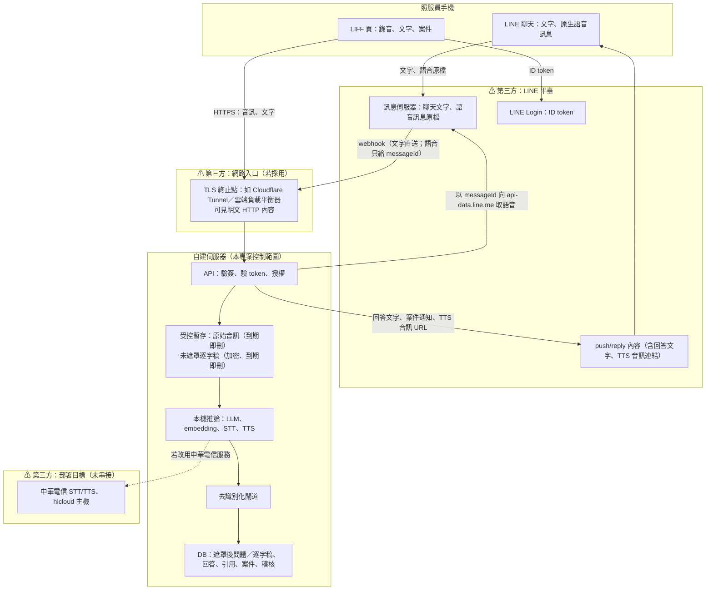

# 資料流與第三方處理邊界

> **不沿用構想書「資料絕不出境／機構資料留在境內」的宣稱。** 採 LINE 作為照服員前端後，以下資料**會經 LINE 平臺處理**；LINE 的資料處理地點與保存政策以 LINE 官方條款為準，本專案未驗證。真實長照資料只能用機構核可的服務；未確認前一律用合成資料開發與展示。

## 1. 邊界總圖

## 2. 逐項資料流

| 資料 | 產生處 | 經過第三方 | 本專案保存 | 保存形式／期限 |
|---|---|---|---|---|
| 聊天文字提問 | LINE 聊天 | **LINE 平臺**（原文） | 遮罩後問題 | webhook 事件只存 ID 與類型；原文以加密暫存給 worker，處理完即清 |
| LINE 原生語音訊息 | LINE 聊天 | **LINE 平臺**（原音） | 遮罩後轉錄 | 取回後進受控暫存，STT 後刪；逾時清除 |
| LIFF 錄音 | LIFF | 網路入口（若有 TLS 終止） | 遮罩後逐字稿＋修訂軌跡 | 原音 STT 後刪（上限 30 分鐘）；未遮罩草稿加密、上限 24 小時或確認即刪 |
| LIFF 身分 | LINE Login | **LINE 平臺** | LINE userId 與本系統帳號的綁定 | 不存 ID token；只存 session 雜湊 |
| 回答文字與出處 | 自建伺服器 | 從 LINE 聊天推送時經 **LINE 平臺** | 回答、引用（指向版本化切塊） | 永久（稽核用） |
| TTS 音訊 | 本機 TTS | 經 LINE 聊天播放時由 LINE 取用該 URL | 快取檔 | 限時簽章 URL、不可枚舉；到期刪檔 |
| 督導回覆 | 督導後台 | 通知時經 **LINE 平臺** | 回覆全文 | 永久（案件紀錄） |
| 稽核紀錄 | 伺服器 | 無 | 行為、對象 ID、結果 | 不含未遮罩文字、金鑰、token |
| 應用程式日誌 | 伺服器 | 無 | 事件摘要 | 不記金鑰、完整 webhook、未遮罩談話、token |

## 3. 去識別化的位置與限制

- 位置：**伺服器端**，在寫入 DB 與送進 LLM 之前。聊天文字與語音在抵達伺服器前已經過 LINE 平臺，**去識別化無法保護 LINE 平臺上的原始訊息**。
- 規則式遮罩：人名＋稱謂（如「王先生」「陳阿嬤」）、房號/床號、電話、身分證字號、機構自訂詞。
- 已知限制：沒有稱謂的單獨人名、外號、方言稱呼可能漏遮；因此「真實資料只能用機構核可的服務」這條要求不能靠遮罩取代。
- 引導：LIFF 與聊天說明提醒照服員提問時用「住民」「家屬」代稱，不講姓名。

## 4. LINE 相關安全措施

| 項目 | 做法 |
|---|---|
| webhook 驗證 | 以 channel secret 對**原始 request body** 做 HMAC-SHA256、Base64，與 `x-line-signature` 以常數時間比較；驗證前不解析 JSON |
| 快速回應 | 驗簽後寫入事件表（`webhookEventId` 唯一）並排工作，立即回 200；長工作不等 reply token |
| 重送 | `deliveryContext.isRedelivery` 事件以 `webhookEventId` 去重，不重複建案 |
| 內容下載 | 只打 `https://api-data.line.me/v2/bot/message/{messageId}/content`；`contentProvider.type = external` 的外部 URL **一律不下載**（防 SSRF） |
| push | 帶 `X-Line-Retry-Key`（每筆通知固定 UUID）；409 視為已受理；429 視為速率或月額度，退避重試並標記 |
| 封鎖 | 收到 `unfollow` 標記帳號不可推送；通知改 `skipped`，照服員下次開 LIFF 仍看得到 |
| LIFF 身分 | 前端只送 ID token；後端呼叫 `POST https://api.line.me/oauth2/v2.1/verify`（帶 LINE Login channel ID）取 `sub`；**不接受前端傳入的 user_id 或角色** |
| channel 關聯 | LINE Login 與 Messaging API channel 須在同一 provider，userId 才一致（官方文件） |
| TTS 播放 URL | HTTPS、HMAC 簽章＋到期時間＋隨機 ID，不可枚舉 |

## 5. 模擬模式的邊界

`LINE_MODE=mock` 時：webhook 簽章仍用設定的測試 secret 真實驗證；reply／push／內容下載改寫進本機 `mock_outbox`／`mock_content`，畫面與 API 回應都帶 `line_mode: "mock"`。**模擬結果不計為真實 LINE 串接成功。**
